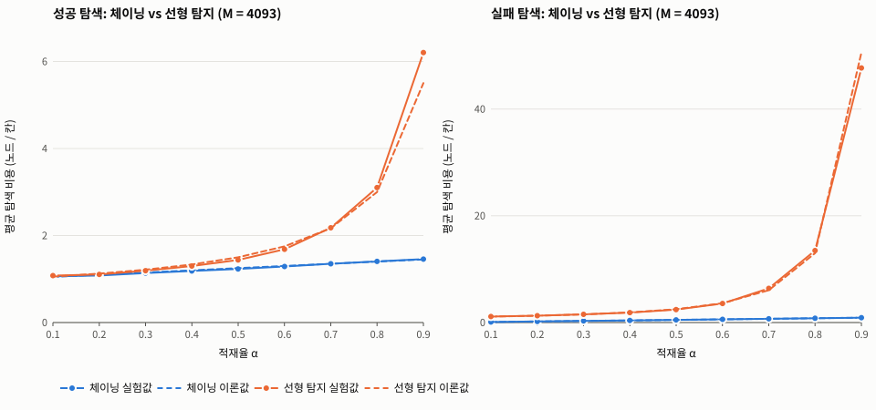

# 과제2 · 에이전트와 함께 만드는 URL 단축기

2026-2 **고급알고리즘**(SIT2001-01) 과제2 저장소입니다. 긴 URL을 짧은 base62 코드로 바꾸고,
짧은 링크로 접속하면 원래 주소로 보내는 서비스를 **직접 구현한 해시 테이블** 위에 만들었습니다.
수업 단계(1~7)에서는 개별 체이닝, 과제(#8)에서는 선형 탐지를 구현하고 두 방식을 비교했습니다.

- 저장소: https://github.com/doyun80292-dev/algorithms-hw2
- 시작 템플릿: [lec-algorithm/hw2-starter-2026](https://github.com/lec-algorithm/hw2-starter-2026)
- 과제 안내: [lec-algorithm.github.io/lecture/article/hw2-2026](https://lec-algorithm.github.io/lecture/article/hw2-2026/)
- 보고서: [`report/final_report.pdf`](report/final_report.pdf)

## 설치

외부 라이브러리를 쓰지 않습니다. Python 3.9 이상만 있으면 됩니다(Codespaces 컨테이너에 들어 있음).

```sh
git clone https://github.com/doyun80292-dev/algorithms-hw2.git
cd algorithms-hw2
# 로컬 Docker를 쓸 때
docker compose up -d && docker compose exec lab bash
```

## 명령

| 하고 싶은 것 | 명령 |
| --- | --- |
| 테스트 (153개) | `make test` |
| 웹 서버 (포트 8000, 개별 체이닝) | `make serve` |
| 웹 서버 (선형 탐지로 리다이렉트) | `make serve TABLE=linear` |
| 적재율 실험 (체이닝, α 0.25~4) | `make experiment` |
| 비교 실험 (체이닝 vs 선형 탐지, α 0.1~0.9) | `make comparison` |
| 보고서 PDF 다시 만들기 (Chrome/Chromium 필요) | `make report` |

## URL 단축기 사용법

1. `make serve` 후 브라우저에서 `http://localhost:8000` (Codespaces는 포트 탭의 8000번 주소)을 엽니다.
2. `http://` 또는 `https://` 로 시작하는 주소를 넣고 **줄이기** → 짧은 링크가 나옵니다.
3. 짧은 링크를 열면 원래 주소로 302 리다이렉트됩니다. 같은 주소를 다시 넣으면 같은 코드가 나옵니다.
4. `/expand?code=<코드>` 로 원본 URL을 리다이렉트 없이 조회할 수 있습니다.
5. `/table` 에서 해시 테이블 내부를 봅니다. 위쪽에서 **개별 체이닝 / 선형 탐지**, **URL→코드 / 코드→URL** 테이블을 고르고,
   노드(칸)를 누르면 호너 해시 계산 과정이 펼쳐집니다. **검색 과정 / 삽입 과정** 버튼은 입력한 키가 어느 칸으로 가고
   어떤 노드·칸을 거치는지 한 줄씩 보여 줍니다.

휴대폰에서 열려면 Codespaces 포트 탭에서 8000번을 **Public**으로 바꾸고 Forwarded Address를 엽니다.
짧은 링크는 `X-Forwarded-Host` 헤더를 먼저 읽으므로 Codespaces 공개 주소로 만들어집니다. 확인 후 포트를 Private으로 되돌립니다.

```python
import sys; sys.path.insert(0, "src")
from shortener import Shortener
s = Shortener(table="linear")          # 또는 "chaining" (기본)
code = s.shorten("https://www.yonsei.ac.kr/")   # '1'
s.expand(code)                          # 'https://www.yonsei.ac.kr/'
s.expand("zz")                          # None (없는 코드)
```

## 해시 테이블

| | 개별 체이닝 `src/hash_table.py` | 선형 탐지 `src/linear_probing.py` |
| --- | --- | --- |
| 칸 | 연결 리스트 머리(`Node`) 또는 `None` | EMPTY / TOMBSTONE / (key, value) |
| 충돌 | 리스트 끝에 붙임 | `index = (index + 1) % M` |
| 삭제 | 리스트에서 떼어 냄 | TOMBSTONE (탐색 경로 유지) |
| 기본 `max_load` | 1.0 | 0.5 |
| 비용 측정 `find()` | 비교한 노드 수 (빈 칸 실패 = 0) | 들여다본 칸 수 (마지막 EMPTY 포함) |
| 이론 (성공 / 실패) | 1 + α/2 / α | (1 + 1/(1−α))/2 / (1 + 1/(1−α)²)/2 |

- 해시: 호너 방식 `h = (31*h + ord(c)) % M` (`src/hashing.py`). 내장 `hash()`는 실행마다 값이 바뀌어 쓰지 않습니다.
- 두 테이블은 같은 인터페이스(`put`, `get`, `find`, `remove`, `len`, `in`, `load_factor`, `snapshot`, `stats`)를 가집니다.
- 짧은 코드는 1부터 증가하는 **일련번호의 base62** (`0-9a-zA-Z`)입니다. URL 해시값을 코드로 쓰지 않습니다.
- `src/`에서 `dict`, `set`, `hash()`를 쓰지 않는지 `python3 tools/check_rules.py`(ast 검사, `make test`에 포함)로 확인합니다.

## 실험 결과

| 파일 | 내용 |
| --- | --- |
| `experiments/results.csv`, `results.svg` | 체이닝, M=4093, α 0.25~4.00 |
| `experiments/comparison_results.csv`, `comparison_results.svg` | 두 방식, M=4093, α 0.1~0.9, 같은 키·같은 해시 |

시드가 고정되어 있어 같은 명령은 같은 CSV를 만듭니다. 해석은 보고서 8절에 있습니다.



## 파일 구성

```
SPEC.md                         명세 (경계 사례 목록 = 테스트 목록)
PLAN.md                         구현 계획
.github/copilot-instructions.md 에이전트 규칙 (SPEC 우선, 금지 구문, TDD, Git Flow)
src/        base62.py hashing.py hash_table.py linear_probing.py shortener.py server.py
tests/      test_base62 test_hash_table test_linear_probing test_shortener test_server test_rules (+ table_contract.py)
experiments/ probe_experiment.py comparison_experiment.py urlgen.py svgplot.py + CSV/SVG
report/     build_report.py agent_errors.html final_report.pdf
tools/      catchup.sh check_rules.py
```

## 작업 방식 (Git Flow)

`main`(제출) ← `develop`(통합) ← `feature/<이슈번호>-<이름>`. 이슈 #1~#8이 단계와 같고,
커밋 메시지는 `Step N: 한 일 (#N)` 형식입니다.
